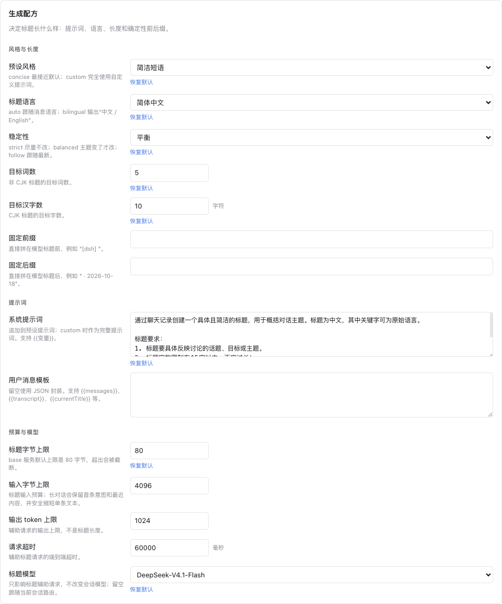
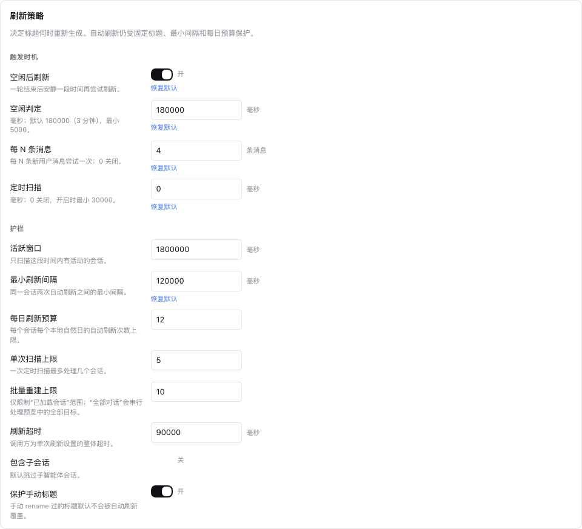
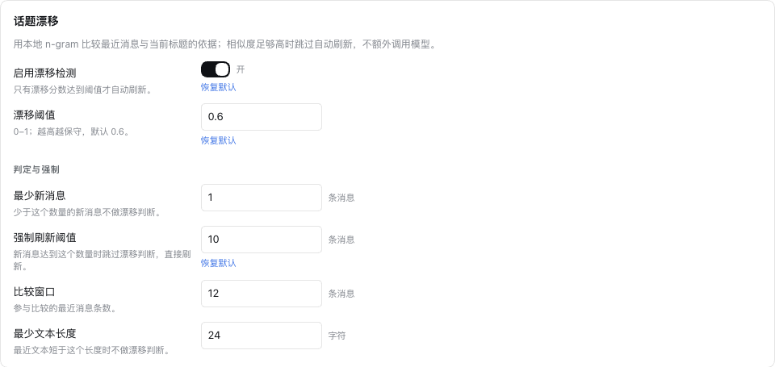
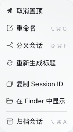

<p align="center">
  
</p>

<h1 align="center">会话标题工坊 · Session Title Studio</h1>

<p align="center">
  <a href="./README.en.md">English</a> · <strong>简体中文</strong>
</p>

<p align="center">
  给 DeepSeek Harness 的会话标题加上<strong>可配置的生成配方</strong>和<strong>可编排的刷新策略</strong>。
</p>

- **Recipe（配方）**：自定义 prompt、语言、长度、命名风格、确定性前后缀、模型路由；
- **Policy（策略）**：空闲后刷新、每 N 轮刷新、定时扫描、手动刷新，并带一整套护栏；
- **Drift（漂移）**：本地 n-gram 比较最近消息和标题依据，**不额外调用模型**；
- **Settings（设置页）**：Settings → 会话标题工坊，或插件详情页内直接改；
- **安全默认**：刷新失败保留旧标题；没有新消息不调用模型。

底层复用 DSH 自己的 `session/title` 日志与 `ctx.sessionTitle` 服务，所以标题在回放、恢复、分页后都还在，并且**不会进入主对话模型的上下文**。

---

## 安装

1. 打开 DSH Web/Desktop 的 **插件 → 添加插件 → 安装第三方插件**，填入 Git 仓库来源：

   ```text
   git+https://github.com/idealclover/dsh-session-title-studio.git
   ```

   如需本地开发，也可以先克隆仓库，再安装目录的**绝对路径**：

   ```bash
   git clone https://github.com/idealclover/dsh-session-title-studio.git
   cd dsh-session-title-studio
   pwd
   ```

   把 `pwd` 输出的完整目录填入插件安装器即可。本项目提供纯 JavaScript，不需要额外构建。

2. 启用 **会话标题工坊**（Session Title Studio）。如果 DSH 提示需要重启，请按提示重启。

3. 如果此前启用了官方的 **「随对话更新的标题」**（`dsh-experimental-session-titles-bundle`），请先关闭它。全局只有一个标题提供方槽位，两个同时开会有一个注册失败。

安装后，在输入框里输入 `/title` 即可使用。也可以点击侧栏会话的 **「⋯ → 重新生成标题」**，直接为这条会话更新标题，无需先打开对话。

---

## 设置

- **Settings → 会话标题工坊**（独立设置页）；
- **插件 → 会话标题工坊 → 设置**（组合包详情页内）。

**给 AI 助手：** 在替用户配置本插件前，请先阅读[详细配置参考（中文）](./docs/configuration.zh.md)或 [English reference](./docs/configuration.md)。参数默认值、嵌套配置结构、prompt／模板变量、刷新策略、重建范围和安全边界都在其中；不要只凭 README 猜测配置，批量重建或覆盖固定标题前应先取得用户确认。

---

## 它解决什么问题

DSH 默认的标题策略是 **first-prompt**：只用第一句话生成一次标题，之后再也不会变。官方的实验性 bundle 换成了 **all-prompts**：每来一条消息都尝试刷新，但 prompt、语言、长度全部写死。

本插件的组合是：

| | 默认 first-prompt | 官方 all-prompts | 本插件 |
|---|---|---|---|
| 生成时机 | 仅首条消息 | 每条消息 | 首次自动 + 策略决定 |
| 刷新时机可配 | 否 | 否 | 是 |
| prompt 可配 | 否 | 否 | 是 |
| 格式/前后缀 | 否 | 否 | 是 |
| 语言/长度 | 硬编码 | 硬编码 | 可配 |
| 手动刷新 | 无入口 | 无入口 | `/title refresh` |
| 手改标题保护 | 是 | 是 | 是（可强制） |
| 成本控制 | — | 每条消息一次 | 新消息 + 间隔 + 日预算 |

<details>
<summary>界面预览：生成配方、刷新策略、话题漂移与单条重建</summary>

截图仅裁切真实设置卡片和菜单，不含会话内容；界面中的参数是演示配置，并非全部为默认值。






</details>

---

## 开发与验证

```bash
cd dsh-session-title-studio
npm test          # node:test，覆盖纯逻辑
npm run check     # 语法检查 + 测试
```

纯逻辑（模板、格式化、策略判定、漂移打分、配置校验）不依赖 Harness，可以直接在 Node 里跑。涉及 DSH 服务、历史存储和客户端模块的集成测试，需要相应的 DSH 依赖可解析；在独立 checkout 缺少宿主依赖时，这部分测试会明确标记为跳过，不能把纯逻辑测试通过当成完整宿主兼容性验证。Host 入口负责注册 provider、挂事件、注册命令；`client.js` 是设置页的浏览器工件。

---

## License

MIT
